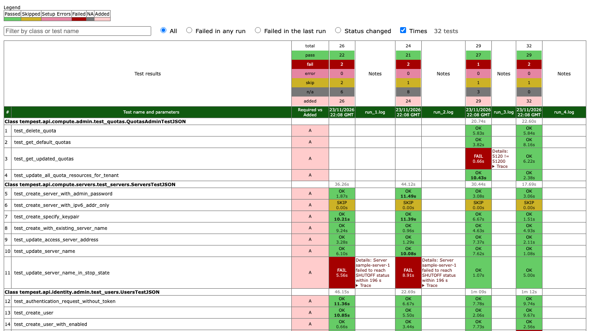
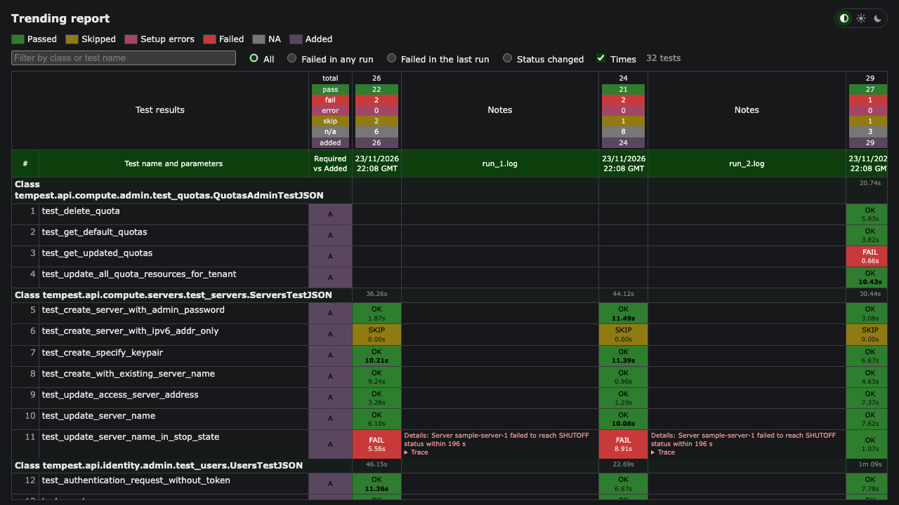
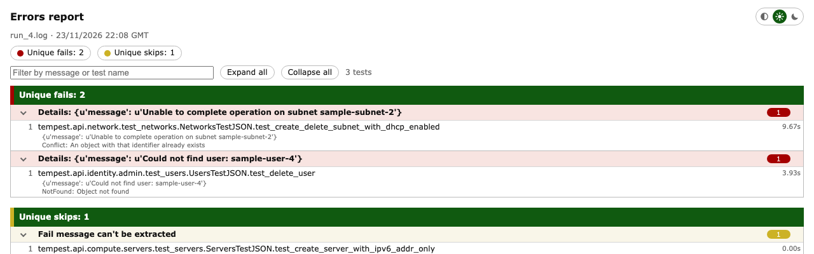

# tempest-parser

[](https://github.com/savex/tempest-parser/actions/workflows/tests.yml)
[](https://github.com/savex/tempest-parser/actions/workflows/release.yml)
[](https://github.com/savex/tempest-parser/actions/workflows/version.yml)
[](https://pypi.org/project/TempestParser/)


[](https://github.com/savex/tempest-parser/blob/master/LICENSE)

Imports test results from many runs, matches the tests by class, name and options, and builds HTML and CSV
reports to track their statuses over time.

> **Status: maintained.** All six input formats and the three reports work and are covered by tests in CI.
> The latest release is [3.0.0](https://github.com/savex/tempest-parser/releases/tag/v3.0.0), on
> [PyPI](https://pypi.org/project/TempestParser/). See [Project status](#project-status).

## Foreword

When you run tempest, you probably want to review the results in a human manner.

You run it once again... and again... and a couple more times the next day... and you end up with 20+ files
in the `.testrepository` folder. You start digging into how a specific tempest test ran yesterday and how its
result changed today. `grep`, `less`... Brain goes hot.

Honestly, Subunit's CLI output is good enough for reading the word PASSED at the end... and the summary.

So, there is a need to:
- import tempest test results
- match tests by class, test name and options
- produce a report to work with test statuses and track them over time
- have error messages added to the report

## Example reports

Made by `tparser` from four made-up runs in
[tests/data/trending](https://github.com/savex/tempest-parser/tree/master/tests/data/trending); the commands are in
[examples/README.md](https://github.com/savex/tempest-parser/blob/master/examples/README.md). Open a report in the browser with **view**, or download it
with **source**.

| Report | Command | Files |
|---|---|---|
| Trending, table | `tparser -d -r trending.html runs/` | [view](https://htmlpreview.github.io/?https://github.com/savex/tempest-parser/blob/master/examples/trending_report.html) · [source](https://github.com/savex/tempest-parser/blob/master/examples/trending_report.html) |
| Trending, table, without messages | `tparser -r trending.html runs/` | [view](https://htmlpreview.github.io/?https://github.com/savex/tempest-parser/blob/master/examples/trending_report_brief.html) · [source](https://github.com/savex/tempest-parser/blob/master/examples/trending_report_brief.html) |
| Trending, grid | `tparser -d -r trending.html --html-layout grid runs/` | [view](https://htmlpreview.github.io/?https://github.com/savex/tempest-parser/blob/master/examples/trending_report_grid.html) · [source](https://github.com/savex/tempest-parser/blob/master/examples/trending_report_grid.html) |
| Unique errors, table | `tparser -e errors.html run_4.log` | [view](https://htmlpreview.github.io/?https://github.com/savex/tempest-parser/blob/master/examples/errors_report_run_4.html) · [source](https://github.com/savex/tempest-parser/blob/master/examples/errors_report_run_4.html) |
| Unique errors, grid | `tparser -e errors.html --html-layout grid run_4.log` | [view](https://htmlpreview.github.io/?https://github.com/savex/tempest-parser/blob/master/examples/errors_report_run_4_grid.html) · [source](https://github.com/savex/tempest-parser/blob/master/examples/errors_report_run_4_grid.html) |

**Trending report** (`-r`, table layout): one row per test, one column per run, with each run's totals,
times under the statuses (the slowest in bold) and a filter bar.



**Trending report, grid layout** (`--html-layout grid`) in dark mode: the header and test names stay in
view while scrolling; the icons at the top right switch between system, light and dark colours.



**Unique errors report, grid layout** (`-e --html-layout grid`): failures and skips grouped by message,
each group opening to its tests and times.



## Installing

The latest published version can be installed with pip:

```bash
pip install tempestparser
```

or from a cloned git repo:

```bash
pip install .
```

## Usage

The tool was originally made for an "import, match, export" flow: produce a CSV with tests matched by class
and name against the list of tests that was originally executed.

```bash
tparser -c matched.csv tempest.log
```

A folder can be used too:

```bash
tparser -c matched.csv folder1
```

HTML trending report:

```bash
tparser -f t_xml -r trending.html tempest.xml
```

or

```bash
tparser -f t_xml -r trending.html folder1
```

The report has a filter bar: type words from a class or test name, or show only tests that failed in any
run, failed in the last run, or changed status. Each result shows the test's time (the slowest in bold),
and each class row the class's total time per run. Add messages and tracebacks to the report with `-d`
(tracebacks are folded; click **Trace** to open one):

```bash
tparser -f t_xml -r trending.html -d folder1
```

`--html-layout grid` lays the same report out with CSS grid instead of a table: the header and the test
names stay in view while scrolling, and it follows the system's dark mode or a light / dark switch
next to the title. It needs a browser from 2024 or later:

```bash
tparser -r trending.html --html-layout grid folder1
```

To avoid scrolling the report back and forth, you can produce a unique errors report (see below).
Note that it needs a single test run file:

```bash
tparser -e errors.html single_run.json
```

This report groups FAILs and SKIPs by their main message to produce lists of unique errors and skips.
With `--html-layout grid`, each message is a collapsible group with a filter, **Expand all** /
**Collapse all** buttons and the same light / dark switch as the grid trending report.
If there is no main message, it is taken from the trace: the line starting with `Details: ` becomes the main
message, and additional lines are those that:
- don't start with whitespace (regular expression `\s`)
- don't start with `Trace`

To parse k8s conformance reports, use the raw XML format:

```bash
tparser -f r_xml -r conformance.html conformance.xml
```

Conformance and other k8s tests are often spread across several files. They can be combined into a single
report:

```bash
tparser -d -r tests.html -f r_xml --force-single conformance_folder
```

You can also leave specific statuses out of the report, say 2k+ SKIPs. `--omit-status` can be used several
times:

```bash
tparser -d -r tests.html -f r_xml --force-single --omit-status OK conformance_folder
```

Results can be piped in as a subunit stream:

```bash
stestr last --subunit | tparser -r trending.html
```

In a CI pipeline, write a JSON summary of the runs and fail the step (exit code 3) when tests failed:

```bash
stestr last --subunit | tparser -r trending.html -j summary.json --fail-on FAIL --fail-on ERROR
```

### Options

| Option | Meaning |
|---|---|
| `-f, --input-format` | `log`, `t_xml`, `r_xml`, `json`, `csv` or `subunit`. Detected from the extension when omitted; stdin defaults to `subunit`. |
| `-r, --html-trending-filename` | Write the HTML trending report. |
| `--xml-time-unit` | Unit of XML test times, `s` or `ms`. Without it, a file with whole numbers only is read as milliseconds. |
| `--html-layout` | HTML report layout (`-r` and `-e`): `table` (default) or `grid` (CSS grid, sticky headers, light / dark switch). |
| `-e, --html-errors-filename` | Write the HTML unique errors report (single file input only). |
| `-c, --csv-file` | Write the CSV report. |
| `-j, --json-file` | Write a JSON summary: per run its name, file, date, counts per status and total time. |
| `--fail-on` | Exit with code 3 when any run has a test with this status (`FAIL`, `ERROR`, ...). Repeatable. |
| `-d, --detailed` | Include messages and tracebacks. |
| `-i, --include-required` | Add the baseline test list from the config as the first column. |
| `--omit-status` | Leave tests with this status (`OK`, `FAIL`, `ERROR`, `SKIP`, ...) out. Repeatable. |
| `-q, --quiet` | Print errors only. |
| `-V, --version` | Print the version and exit. |
| `--force-single` | Treat all files in a folder as a single run. |
| `--run-name` | Name of the run in the reports instead of the file name (single file or stdin). |
| `--run-date` | Date of the run, ISO 8601 (`2026-11-23T14:30`, UTC unless an offset is given), instead of the file's modification time (single file or stdin). |
| `--config-file` | Use this config file (absolute path) instead of the packaged one. |

## Imported formats

### .log files
Tempest console output, captured with a redirect (`tempest run ... | tee tempest.log`), from a CI job
log, or from the numbered files in the `.testrepository` folder. Both the current stestr layout
(`{0} tempest.api....test_x [1.2s] ... ok`, with `Captured traceback:` sections, the `Totals` summary
and `stestr --slowest`) and the older testr layout (class lines with indented test lines) are read.
CI timestamp prefixes such as `2026-01-01 10:00:00.123456 | ` are removed. The log has no date: give one
with `--run-date`, or the file's modification time is used.

### .xml files
jUnit XML files exported from subunit (`t_xml`, the default for `.xml`), or raw jUnit XML from k8s
conformance and pytest (`r_xml`, test names used as is).

### .json files
[Rally](https://github.com/openstack/rally) tool export:

```bash
rally verify results --json --output-file result1.json
```

### .csv files
CSV files exported by tparser itself (`-c`), or xunit CSV files. An export with several runs imports
back as the same runs, dated from its header and named after their files when it was written with `-d`;
a baseline column (`-i`) comes back as the `required` run. So a CSV can stand in for the original files:

```bash
tparser -c all_runs.csv folder1
tparser -r trending.html all_runs.csv
```

### .subunit files
Subunit v2 streams saved to a file.

## Project status

| Part | State |
|---|---|
| Input: Tempest log, subunit, jUnit XML (Tempest and raw / k8s), Rally JSON, CSV | Done |
| Reports: HTML trending, HTML unique errors, CSV | Done |
| Tests (smoke, functional, integration) and CI on Linux, macOS and Windows, Python 3.11–3.15 | Done |
| Tag-based versioning, Bump version and Release workflows | Done; 0.3.0 and 3.0.0 were released through them |
| Upload to PyPI from CI | Done (on from 3.0.0) |
| Project rules for contributors ([CLAUDE.md](https://github.com/savex/tempest-parser/blob/master/CLAUDE.md)) | Done |

The plan is in [documents/plan.md](https://github.com/savex/tempest-parser/blob/master/documents/plan.md), the specification in
[documents/specs.md](https://github.com/savex/tempest-parser/blob/master/documents/specs.md) and the changes in [changelog.md](https://github.com/savex/tempest-parser/blob/master/changelog.md).

## Development

With [uv](https://docs.astral.sh/uv/), which creates `.venv` from `uv.lock`:

```bash
uv sync
```

```bash
uv run pytest
```

```bash
uv run ruff check .
```

```bash
uv run mypy
```

```bash
uv run python scripts/check-test-tags.py
```

Without uv (pip 25.1 or newer): `python3 -m venv .venv`, then
`.venv/bin/pip install -e . --group dev`.

Dependencies are declared in `pyproject.toml`; after changing them, run `uv lock` and commit `uv.lock`.
Dependabot proposes weekly updates for `uv.lock` and the GitHub Actions.

Tests live in `tests/smoke`, `tests/functional` and `tests/integration`; the folder is the test's tag
(`pytest -m smoke` runs one tag). Sample inputs are in `tests/data`.

Versions come from `v*` git tags: setuptools-scm reads the tag when the package is built, and commits
after a tag build as `X.Y.Z.devN`. `scripts/version.sh versions` shows the latest tag and the newest
`changelog.md` release, and whether they agree; see the script's header for the other commands.

CI (`.github/workflows`):
- **Tests** runs on pull requests and pushes to `master`: ruff, mypy, actionlint, package build and
  `twine check`, version and test-tag checks, then the tests on ubuntu, macOS and Windows with Python
  3.11–3.15, with a minimum coverage (`fail_under` in `pyproject.toml`).
- **Version tracking** reports the version on every push to `master`.
- **Bump version** (manual) picks the next version, updates `changelog.md`, commits
  `Release vX.Y.Z`, tags it and starts **Release**.
- **Release** builds the sdist and wheel, smoke-tests them and publishes a GitHub release with the
  changelog section as notes. It then uploads to TestPyPI through the GitHub environment `stage` and,
  after that, to PyPI through `prod` (trusted publishing). Each upload runs only when its environment's
  variable `PUBLISH` is `true`, and both environments accept only `v*` tags and `master`.

## Credits

Thanks to Dmitry Bogun, Alexey Diyan and Dmitriy Zapeka.
